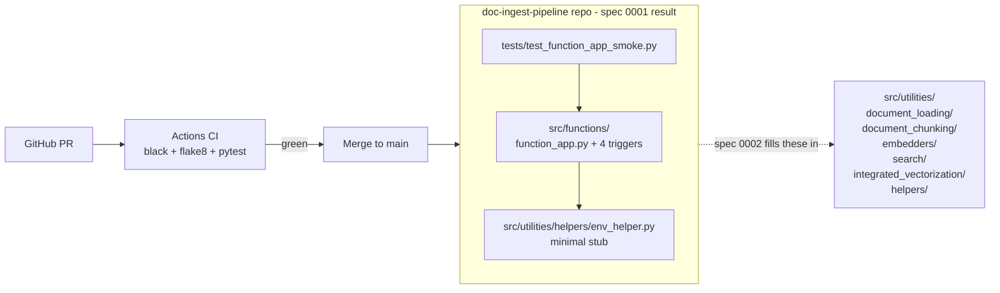

# Technical Specification

This is the technical specification for the spec detailed in [spec.md](spec.md).

> Created: 2026-06-02
> Version: 1.0.0

## Technical Requirements

### Target File Layout (created by this spec)

```
doc-ingest-pipeline/
  .editorconfig
  .gitignore
  .pre-commit-config.yaml
  LICENSE
  README.md
  azure.yaml
  pyproject.toml
  poetry.lock                       # generated
  .github/
    copilot-instructions.md         # already exists
    workflows/
      ci.yml                        # new
  src/
    __init__.py
    functions/
      __init__.py
      function_app.py               # ported
      batch_push_results.py         # ported
      batch_start_processing.py     # ported
      add_url_embeddings.py         # ported
      combine_pages_chunknos.py     # ported
      host.json                     # ported (trimmed)
      .funcignore                   # ported
      local.settings.json.sample    # ported (trimmed)
    utilities/
      __init__.py
      helpers/
        __init__.py
        env_helper.py               # NEW stub (minimal surface)
  tests/
    __init__.py
    conftest.py
    test_function_app_smoke.py      # new
```

All other `src/utilities/` subpackages (`common/`, `document_loading/`, `document_chunking/`, `embedders/`, `integrated_vectorization/`, `search/`, `helpers/embedders/`, `helpers/config/`) are **created as empty packages with `__init__.py` only** so that ported entry-point imports do not break. Population happens in spec 0002.

### `pyproject.toml` Dependency Set (Phase 1 / Spec 0001)

Runtime dependencies (intentionally narrow; expansion belongs to spec 0002):

- `python = "^3.10"`
- `azure-functions = "1.24.0"`
- `azure-storage-blob = "12.29.0"`
- `azure-storage-queue = "12.16.0"`
- `azure-identity = "1.25.3"`
- `python-dotenv = "1.2.2"`

Dev dependencies:

- `pytest = "^9.0.3"`
- `pytest-asyncio = "^1.3.0"`
- `pytest-cov = "7.1.0"`
- `pytest-mock = "^3.15.0"`
- `flake8 = "7.3.0"`
- `black = "26.5.1"`
- `pre-commit = "4.6.0"`

Versions match the parent accelerator's `pyproject.toml` exactly. Any deviation requires an ADR.

### `EnvHelper` Stub (Minimum Surface for Spec 0001)

The stub `src/utilities/helpers/env_helper.py` exposes only the attributes referenced by the ported entry points after their imports are repointed:

- `DOCUMENT_PROCESSING_QUEUE_NAME: str` (default `"doc-processing"`)
- `AZURE_BLOB_CONTAINER_NAME: str`
- `AZURE_BLOB_ACCOUNT_NAME: str`
- `AZURE_SEARCH_USE_INTEGRATED_VECTORIZATION: bool`
- `MANAGED_IDENTITY_CLIENT_ID: str | None`
- `is_auth_type_keys(self) -> bool`

Attribute names match the parent verbatim so spec 0002's `EnvHelper` port can replace this file with no call-site changes. All other attributes raise `AttributeError` with a message pointing to spec 0002.

### CI Workflow (`.github/workflows/ci.yml`)

- Trigger: `push` to any branch, `pull_request` to `main`.
- Runner: `ubuntu-latest`.
- Steps:
  1. `actions/checkout@v5`
  2. Install Python 3.11 via `actions/setup-python@v6` with `cache: 'pip'`.
  3. Install Poetry via the official installer (pin to a recent stable; document version in workflow).
  4. `poetry install --no-interaction --no-root --with dev`
  5. `poetry run black --check src tests`
  6. `poetry run flake8 src tests`
  7. `poetry run pytest -q --cov=src --cov-report=term-missing`
- Concurrency: cancel-in-progress on the same branch.
- No deployment, no Azure auth in CI for this spec.

### Pre-commit Hooks (`.pre-commit-config.yaml`)

- `pre-commit-hooks` (trailing-whitespace, end-of-file-fixer, check-yaml, check-added-large-files).
- `psf/black` pinned to 26.5.1, target `py310`.
- `pycqa/flake8` pinned to 7.3.0.

### Smoke Test (`tests/test_function_app_smoke.py`)

Verifies:

1. `from src.functions.function_app import app` succeeds (no import-time exceptions).
2. The `app` instance exposes blueprints for `batch_push_results`, `batch_start_processing`, `add_url_embeddings`.
3. The queue-trigger name resolves to `doc-processing`.

No network, no Azurite, no SDK constructor calls. Anything requiring SDK clients is patched with `pytest-mock` to return `MagicMock()`.

### Import Path Changes During Port

In the parent, the entry points import as:

```python
from utilities.helpers.azure_blob_storage_client import AzureBlobStorageClient
from utilities.helpers.env_helper import EnvHelper
from utilities.helpers.embedders.embedder_factory import EmbedderFactory
from utilities.search.search import Search
```

In the new repo, all imports become absolute from `src`:

```python
from src.utilities.helpers.azure_blob_storage_client import AzureBlobStorageClient
from src.utilities.helpers.env_helper import EnvHelper
from src.utilities.helpers.embedders.embedder_factory import EmbedderFactory
from src.utilities.search.search import Search
```

For this spec, the modules `azure_blob_storage_client`, `embedder_factory`, and `search.search` do not yet exist. Imports of these are **commented out** with `# TODO(spec-0002): re-enable once helpers are ported` and the corresponding handler bodies are wrapped:

```python
raise NotImplementedError(
    "Helper modules not yet ported -- see spec 0002."
)
```

The smoke test verifies registration only and does not invoke handler bodies, so this is sufficient.

### `host.json` Trim

The ported `host.json` removes any extension bundle entries unrelated to:

- HTTP
- Storage Queues
- Event Grid
- Azure Blob Storage

If the parent's `host.json` is already minimal and only references the standard Functions extension bundle, copy as-is.

### `local.settings.json.sample` Trim

Removes these keys (chat / orchestrator / PG / Cosmos / Speech / Content Safety surface):

- All `AZURE_OPENAI_*` chat-completion settings (keep embedding-related settings as comments for spec 0002).
- `AZURE_CONTENT_SAFETY_*`
- `AZURE_SPEECH_*`
- `AZURE_POSTGRES_*`, `POSTGRES_*`
- `AZURE_COSMOSDB_*`
- `ORCHESTRATION_*`, `CONVERSATION_*`, `AZURE_OPENAI_VISION_*`

Retains:

- `AzureWebJobsStorage`
- `FUNCTIONS_WORKER_RUNTIME`
- `AZURE_BLOB_*`, `AZURE_SEARCH_*`, `DOCUMENT_PROCESSING_QUEUE_NAME`
- `MANAGED_IDENTITY_CLIENT_ID`
- `LOGLEVEL`

## Approach Options

**Option A: Single big-bang port (entry points + utilities + Bicep all in one PR)**
- Pros: One review cycle, end-to-end working pipeline at the end.
- Cons: Massive PR, hard to review, blocks any parallel work, late integration with CI, violates the per-PR DoD in [best-practices.md](../../standards/best-practices.md).

**Option B: Phased ports across multiple specs (Selected)**
- Pros: Each PR small and reviewable; CI runs from day one; failures localized to one porting step; aligns with the spec-driven workflow.
- Cons: Function app cannot process documents end-to-end until spec 0002 lands. Acceptable because Phase 1 success criteria are explicitly cross-spec.

**Rationale:** Option B matches the per-PR Definition of Done and the spec-driven workflow already adopted. The smoke test gives us a meaningful CI signal even before utilities are present.

## Architecture Diagram



## External Dependencies

No new external dependencies introduced by this spec. All packages added to `pyproject.toml` are already present in the parent accelerator at the same versions.

- **azure-functions 1.24.0** - Azure Functions Python v2 worker. **Justification:** Required by the ported entry points; matches parent.
- **azure-storage-blob 12.29.0, azure-storage-queue 12.16.0, azure-identity 1.25.3** - Referenced by import in the entry points (even though full client construction is gated behind `NotImplementedError` until spec 0002). **Justification:** Including them now avoids `ImportError` on `func host start` and keeps the dependency graph stable.
- **python-dotenv 1.2.2** - Used by the parent's `EnvHelper`; including for forward compatibility with the spec 0002 port.
