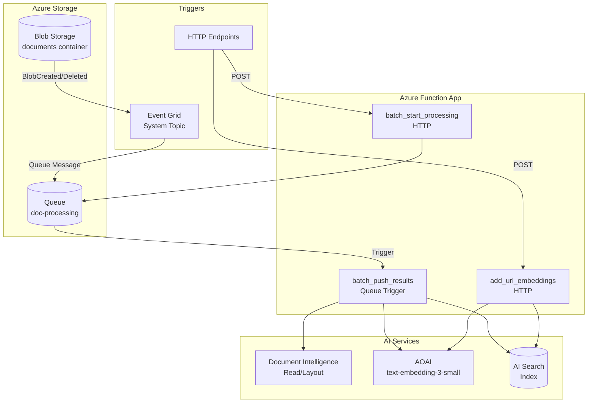
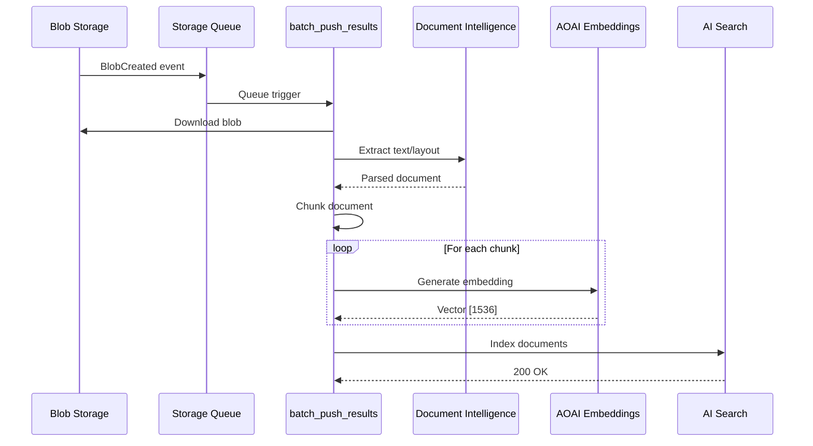
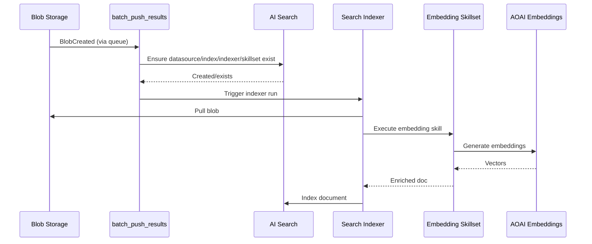
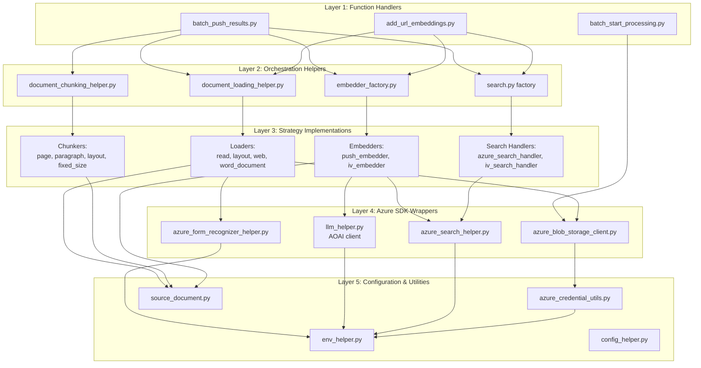
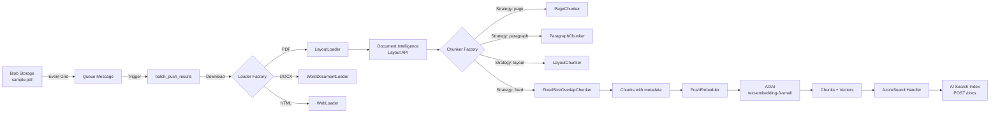
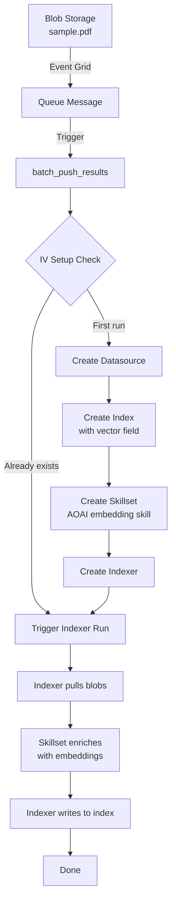

# Technical Specification - Helper Modules Port

> Spec: 0002 - Port Helper Modules and Utilities
> Created: 2026-06-02
> Status: Planning

## Table of Contents

1. [Architecture Overview](#architecture-overview)
2. [Module Dependency Graph](#module-dependency-graph)
3. [Data Flow Diagrams](#data-flow-diagrams)
4. [Port Strategy Matrix](#port-strategy-matrix)
5. [Configuration Reference](#configuration-reference)
6. [Testing Strategy](#testing-strategy)

---

## Architecture Overview

### System Context



### Two Ingestion Modes

#### Push Mode (`AZURE_SEARCH_USE_INTEGRATED_VECTORIZATION=false`)



#### Integrated Vectorization Mode (`AZURE_SEARCH_USE_INTEGRATED_VECTORIZATION=true`)



---

## Module Dependency Graph

### Layered Architecture



### Import Chain (Representative Example: `batch_push_results`)

```python
# batch_push_results.py
from src.utilities.helpers.document_loading_helper import DocumentLoadingHelper
from src.utilities.helpers.document_chunking_helper import DocumentChunkingHelper
from src.utilities.helpers.embedders.embedder_factory import EmbedderFactory
from src.utilities.search.search import Search
from src.utilities.helpers.azure_blob_storage_client import AzureBlobStorageClient
from src.utilities.helpers.env_helper import EnvHelper

# DocumentLoadingHelper
from src.utilities.document_loading.strategies import get_document_loader
    # → read.py, layout.py, web.py, word_document.py
    # → azure_form_recognizer_helper.py
    # → azure_blob_storage_client.py

# DocumentChunkingHelper
from src.utilities.document_chunking.strategies import get_document_chunker
    # → page.py, paragraph.py, layout.py, fixed_size_overlap.py
    # → tiktoken (external)

# EmbedderFactory
from src.utilities.helpers.embedders.push_embedder import PushEmbedder
from src.utilities.helpers.embedders.integrated_vectorization_embedder import IntegratedVectorizationEmbedder
    # PushEmbedder → llm_helper.py → openai SDK
    # IV Embedder → azure_search_helper.py, integrated_vectorization modules

# Search
from src.utilities.search.azure_search_handler import AzureSearchHandler
from src.utilities.search.integrated_vectorization_search_handler import IntegratedVectorizationSearchHandler
    # → azure_search_helper.py
    # → azure-search-documents SDK
```

---

## Data Flow Diagrams

### Push Mode: Document Processing Pipeline



### Integrated Vectorization Mode: Indexer-Driven Pipeline



---

## Port Strategy Matrix

### File-by-File Mapping

| Source Path (parent repo) | Action | Target Path | Modifications | Task |
|---|---|---|---|---|
| **Common Types** ||||
| `code/backend/batch/utilities/common/source_document.py` | REUSE | `src/utilities/common/source_document.py` | None | T0002-01 |
| **Configuration** ||||
| `code/backend/batch/utilities/helpers/config/config_helper.py` | REUSE | `src/utilities/helpers/config/config_helper.py` | None | T0002-02 |
| `code/backend/batch/utilities/helpers/config/embedding_config.py` | REUSE | `src/utilities/helpers/config/embedding_config.py` | None | T0002-02 |
| `code/backend/batch/utilities/helpers/config/integrated_vectorization_config.py` | REUSE | `src/utilities/helpers/config/integrated_vectorization_config.py` | None | T0002-02 |
| **Core Helpers** ||||
| `code/backend/batch/utilities/helpers/azure_credential_utils.py` | REUSE | `src/utilities/helpers/azure_credential_utils.py` | None | T0002-03 |
| `code/backend/batch/utilities/helpers/azure_blob_storage_client.py` | MODIFY | `src/utilities/helpers/azure_blob_storage_client.py` | Use managed identity by default | T0002-03 |
| `code/backend/batch/utilities/helpers/azure_search_helper.py` | REUSE | `src/utilities/helpers/azure_search_helper.py` | None | T0002-03 |
| `code/backend/batch/utilities/helpers/azure_form_recognizer_helper.py` | REUSE | `src/utilities/helpers/azure_form_recognizer_helper.py` | None | T0002-03 |
| `code/backend/batch/utilities/helpers/env_helper.py` | MODIFY | `src/utilities/helpers/env_helper.py` | **Remove:** `ORCHESTRATOR_*`, `CHAT_*`, `POSTGRES_*`, `COSMOS_*`, `SPEECH_*`, `CONTENT_SAFETY_*` variables | T0002-04 |
| `code/backend/batch/utilities/helpers/llm_helper.py` | MODIFY | `src/utilities/helpers/llm_helper.py` | **Remove:** chat completion methods, keep only `generate_embeddings()` | T0002-05 |
| **Document Loading** ||||
| `code/backend/batch/utilities/document_loading/document_loading_base.py` | REUSE | `src/utilities/document_loading/document_loading_base.py` | None | T0002-06 |
| `code/backend/batch/utilities/document_loading/read.py` | REUSE | `src/utilities/document_loading/read.py` | None | T0002-06 |
| `code/backend/batch/utilities/document_loading/layout.py` | REUSE | `src/utilities/document_loading/layout.py` | None | T0002-06 |
| `code/backend/batch/utilities/document_loading/web.py` | REUSE | `src/utilities/document_loading/web.py` | None | T0002-06 |
| `code/backend/batch/utilities/document_loading/word_document.py` | REUSE | `src/utilities/document_loading/word_document.py` | None | T0002-06 |
| `code/backend/batch/utilities/document_loading/strategies.py` | REUSE | `src/utilities/document_loading/strategies.py` | None | T0002-06 |
| `code/backend/batch/utilities/helpers/document_loading_helper.py` | REUSE | `src/utilities/helpers/document_loading_helper.py` | None | T0002-06 |
| **Document Chunking** ||||
| `code/backend/batch/utilities/document_chunking/document_chunking_base.py` | REUSE | `src/utilities/document_chunking/document_chunking_base.py` | None | T0002-07 |
| `code/backend/batch/utilities/document_chunking/chunking_strategy.py` | REUSE | `src/utilities/document_chunking/chunking_strategy.py` | None | T0002-07 |
| `code/backend/batch/utilities/document_chunking/fixed_size_overlap.py` | REUSE | `src/utilities/document_chunking/fixed_size_overlap.py` | None | T0002-07 |
| `code/backend/batch/utilities/document_chunking/layout.py` | REUSE | `src/utilities/document_chunking/layout.py` | None | T0002-07 |
| `code/backend/batch/utilities/document_chunking/page.py` | REUSE | `src/utilities/document_chunking/page.py` | None | T0002-07 |
| `code/backend/batch/utilities/document_chunking/paragraph.py` | REUSE | `src/utilities/document_chunking/paragraph.py` | None | T0002-07 |
| `code/backend/batch/utilities/document_chunking/json.py` | REUSE | `src/utilities/document_chunking/json.py` | None | T0002-07 |
| `code/backend/batch/utilities/document_chunking/strategies.py` | REUSE | `src/utilities/document_chunking/strategies.py` | None | T0002-07 |
| `code/backend/batch/utilities/helpers/document_chunking_helper.py` | REUSE | `src/utilities/helpers/document_chunking_helper.py` | None | T0002-07 |
| **Embedders** ||||
| `code/backend/batch/utilities/helpers/embedders/embedder_base.py` | REUSE | `src/utilities/helpers/embedders/embedder_base.py` | None | T0002-08 |
| `code/backend/batch/utilities/helpers/embedders/embedder_factory.py` | MODIFY | `src/utilities/helpers/embedders/embedder_factory.py` | **Remove:** PostgreSQL branch `if use_postgres:` | T0002-08 |
| `code/backend/batch/utilities/helpers/embedders/push_embedder.py` | MODIFY | `src/utilities/helpers/embedders/push_embedder.py` | **Gate:** Image processing behind `ENABLE_IMAGE_VECTORIZATION` (default False, Phase 4) | T0002-08 |
| `code/backend/batch/utilities/helpers/embedders/integrated_vectorization_embedder.py` | REUSE | `src/utilities/helpers/embedders/integrated_vectorization_embedder.py` | None | T0002-08 |
| **Search Handlers** ||||
| `code/backend/batch/utilities/search/search_handler_base.py` | REUSE | `src/utilities/search/search_handler_base.py` | None | T0002-09 |
| `code/backend/batch/utilities/search/azure_search_handler.py` | REUSE | `src/utilities/search/azure_search_handler.py` | None | T0002-09 |
| `code/backend/batch/utilities/search/integrated_vectorization_search_handler.py` | REUSE | `src/utilities/search/integrated_vectorization_search_handler.py` | None | T0002-09 |
| `code/backend/batch/utilities/search/search.py` | MODIFY | `src/utilities/search/search.py` | **Remove:** `if use_postgres:` branch | T0002-09 |
| **Integrated Vectorization** ||||
| `code/backend/batch/utilities/integrated_vectorization/azure_search_datasource.py` | REUSE | `src/utilities/integrated_vectorization/azure_search_datasource.py` | None | T0002-10 |
| `code/backend/batch/utilities/integrated_vectorization/azure_search_index.py` | REUSE | `src/utilities/integrated_vectorization/azure_search_index.py` | None | T0002-10 |
| `code/backend/batch/utilities/integrated_vectorization/azure_search_indexer.py` | REUSE | `src/utilities/integrated_vectorization/azure_search_indexer.py` | None | T0002-10 |
| `code/backend/batch/utilities/integrated_vectorization/azure_search_skillset.py` | REUSE | `src/utilities/integrated_vectorization/azure_search_skillset.py` | None | T0002-10 |
| **Function Handlers** ||||
| `src/functions/batch_push_results.py` | UPDATE | `src/functions/batch_push_results.py` | **Remove:** `NotImplementedError`, wire full pipeline | T0002-11 |
| `src/functions/batch_start_processing.py` | UPDATE | `src/functions/batch_start_processing.py` | **Remove:** `NotImplementedError`, implement batch enumeration | T0002-12 |
| `src/functions/add_url_embeddings.py` | UPDATE | `src/functions/add_url_embeddings.py` | **Remove:** `NotImplementedError`, enable URL fetching | T0002-13 |

### Trim Points for MODIFY Files

#### `env_helper.py` - Variables to Remove

```python
# REMOVE - Chat orchestration (DEC-001, DEC-004)
ORCHESTRATOR_STRATEGY
ORCHESTRATOR_MESSAGES_LANGUAGE
AZURE_OPENAI_CHAT_DEPLOYMENT
AZURE_OPENAI_CHAT_MODEL
AZURE_OPENAI_MAX_TOKENS
AZURE_OPENAI_SYSTEM_MESSAGE
AZURE_OPENAI_TEMPERATURE
AZURE_OPENAI_TOP_P

# REMOVE - PostgreSQL (DEC-002)
POSTGRES_HOST
POSTGRES_PORT
POSTGRES_DATABASE
POSTGRES_USERNAME
POSTGRES_PASSWORD
POSTGRES_SSL_MODE

# REMOVE - Cosmos DB (DEC-001)
AZURE_COSMOSDB_ACCOUNT
AZURE_COSMOSDB_DATABASE
AZURE_COSMOSDB_CONVERSATIONS_CONTAINER
AZURE_COSMOSDB_ENABLE_FEEDBACK

# REMOVE - Speech (DEC-001)
AZURE_SPEECH_KEY
AZURE_SPEECH_REGION
AZURE_SPEECH_RECOGNIZER_LANGUAGES

# REMOVE - Content Safety (Phase 2+)
AZURE_CONTENT_SAFETY_ENDPOINT
AZURE_CONTENT_SAFETY_KEY
```

#### `llm_helper.py` - Methods to Remove

```python
# REMOVE - Chat completion
def get_chat_completion()
def get_chat_completion_with_functions()
def get_streaming_chat_completion()
def format_as_ndjson()

# KEEP - Embedding only
def generate_embeddings()
def get_openai_client()  # If used by embeddings
```

#### `embedder_factory.py` - Branches to Remove

```python
# BEFORE (parent)
def create_embedder():
    if env_helper.USE_POSTGRES:
        return PostgresEmbedder()
    elif env_helper.AZURE_SEARCH_USE_INTEGRATED_VECTORIZATION:
        return IntegratedVectorizationEmbedder()
    else:
        return PushEmbedder()

# AFTER (this repo)
def create_embedder():
    if env_helper.AZURE_SEARCH_USE_INTEGRATED_VECTORIZATION:
        return IntegratedVectorizationEmbedder()
    else:
        return PushEmbedder()
```

#### `search.py` - Factory Simplification

```python
# BEFORE (parent)
def create_search_handler():
    if env_helper.USE_POSTGRES:
        return PostgresSearchHandler()
    elif env_helper.AZURE_SEARCH_USE_INTEGRATED_VECTORIZATION:
        return IntegratedVectorizationSearchHandler()
    else:
        return AzureSearchHandler()

# AFTER (this repo)
def create_search_handler():
    if env_helper.AZURE_SEARCH_USE_INTEGRATED_VECTORIZATION:
        return IntegratedVectorizationSearchHandler()
    else:
        return AzureSearchHandler()
```

---

## Configuration Reference

### Environment Variables by Module

| Variable | Used By | Required | Default | Notes |
|---|---|---|---|---|
| **Storage** |||||
| `AzureWebJobsStorage` | Functions runtime | Yes | (none) | Connection string for function metadata |
| `AZURE_STORAGE_ACCOUNT_NAME` | azure_blob_storage_client | Yes | (from azd) | Managed identity auth |
| `AZURE_BLOB_CONTAINER_NAME` | batch handlers | Yes | `documents` | Source container |
| `DOCUMENT_PROCESSING_QUEUE_NAME` | Event Grid, batch handlers | Yes | `doc-processing` | Queue name |
| **Document Intelligence** |||||
| `AZURE_FORM_RECOGNIZER_ENDPOINT` | azure_form_recognizer_helper | Yes | (from azd) | Document Intelligence endpoint |
| `DOCUMENT_LOADING_STRATEGY` | document_loading_helper | No | `layout` | `read`, `layout` |
| **Chunking** |||||
| `CHUNKING_STRATEGY` | document_chunking_helper | No | `fixed_size_overlap` | `page`, `paragraph`, `layout`, `fixed_size_overlap`, `json` |
| `CHUNK_SIZE` | fixed_size_overlap chunker | No | `512` | Token count |
| `CHUNK_OVERLAP` | fixed_size_overlap chunker | No | `128` | Token overlap |
| **Embeddings** |||||
| `AZURE_OPENAI_ENDPOINT` | llm_helper | Yes | (from azd) | AOAI endpoint |
| `AZURE_OPENAI_EMBEDDING_DEPLOYMENT` | llm_helper | Yes | (from azd) | Deployment name (e.g., `text-embedding-3-small`) |
| `AZURE_OPENAI_EMBEDDING_MODEL` | llm_helper | No | `text-embedding-3-small` | Model name |
| `AZURE_OPENAI_EMBEDDING_DIMENSIONS` | llm_helper | No | `1536` | Vector dimensions |
| **Search** |||||
| `AZURE_SEARCH_SERVICE_ENDPOINT` | azure_search_helper | Yes | (from azd) | AI Search endpoint |
| `AZURE_SEARCH_INDEX_NAME` | search handlers | Yes | (from azd) | Index name |
| `AZURE_SEARCH_USE_INTEGRATED_VECTORIZATION` | embedder_factory, search factory | No | `false` | Mode switch |
| `AZURE_SEARCH_SEMANTIC_SEARCH_CONFIG` | azure_search_helper | No | (none) | Semantic ranker config name |
| **Identity** |||||
| `MANAGED_IDENTITY_CLIENT_ID` | azure_credential_utils | No | (system) | User-assigned MI; defaults to system-assigned |
| **Logging** |||||
| `LOGLEVEL` | All modules | No | `INFO` | `DEBUG`, `INFO`, `WARNING`, `ERROR` |

### Push vs. Integrated Vectorization Mode Comparison

| Aspect | Push Mode | IV Mode |
|---|---|---|
| **Embedding Generation** | Function App (Python) | Indexer Skillset (managed) |
| **Blob Access** | Function downloads blob | Indexer pulls from datasource |
| **Compute Cost** | Function execution time | Indexer runs (metered separately) |
| **Latency** | Single function invocation | Indexer schedule (can be immediate) |
| **Retry Logic** | Queue visibility timeout | Indexer retry policy |
| **Scaling** | Function Consumption scaling | Indexer replica count |
| **Best For** | Full control, custom chunking per doc | Large batch ingestion, simpler ops |

### Chunking Strategy Selection

| Strategy | Use Case | Output |
|---|---|---|
| `page` | Scanned documents, PDFs with page structure | One chunk per page |
| `paragraph` | Well-structured documents | One chunk per paragraph (heuristic: double newline) |
| `layout` | Documents with tables, headers, sections | Chunks preserve layout boundaries |
| `fixed_size_overlap` | General-purpose, token-limited models | Fixed token windows with overlap |
| `json` | Structured data (JSON/JSONL blobs) | One chunk per top-level object |

---

## Testing Strategy

### Unit Tests (per module)

| Module | Test File | Coverage Target | Key Test Cases |
|---|---|---|---|
| `env_helper.py` | `tests/test_env_helper.py` | 80% | All env vars load, missing required vars raise, defaults apply |
| `azure_blob_storage_client.py` | `tests/test_blob_client.py` | 70% | Managed identity auth, download blob, list blobs |
| `document_loading/*.py` | `tests/test_document_loading_*.py` | 75% | Each loader with sample fixture, error handling |
| `document_chunking/*.py` | `tests/test_document_chunking_*.py` | 80% | Each strategy with text fixture, token counting |
| `embedder_factory.py` | `tests/test_embedder_factory.py` | 90% | Mode switch (Push vs. IV), config validation |
| `search.py` | `tests/test_search_factory.py` | 90% | Handler selection, config validation |

### Integration Tests (marked `@pytest.mark.integration`)

| Test | Scenario | Prerequisites |
|---|---|---|
| `test_push_mode_end_to_end.py` | Upload PDF → indexed in Push mode | Live Azure env (rg-doc-ingest-dev) |
| `test_iv_mode_end_to_end.py` | Upload PDF → indexed in IV mode | IV mode enabled |
| `test_blob_deletion.py` | Delete blob → chunks removed | Live Azure env |
| `test_url_ingestion.py` | POST URL → content indexed | Live Azure env |
| `test_mode_equivalence.py` | Same blob in both modes → same chunks | Both modes configured |

### Smoke Test Script

**File:** `tests/smoke_test.sh`

```bash
#!/usr/bin/env bash
set -euo pipefail

# Upload 3 PDFs with different strategies
az storage blob upload --account-name $STORAGE_ACCOUNT --container-name documents --name test-read.pdf --file ./fixtures/sample.pdf --metadata "loading_strategy=read"
az storage blob upload --account-name $STORAGE_ACCOUNT --container-name documents --name test-layout.pdf --file ./fixtures/sample.pdf --metadata "loading_strategy=layout"
az storage blob upload --account-name $STORAGE_ACCOUNT --container-name documents --name test-page.pdf --file ./fixtures/sample.pdf --metadata "chunking_strategy=page"

# Wait 60 seconds
sleep 60

# Query index
az search query --service-name $SEARCH_SERVICE --index-name $INDEX_NAME --search "sample" --top 10

# Verify results
# Expected: >= 3 documents with different chunk_id patterns
```

---

## Success Metrics

### Code Quality Metrics

| Metric | Target | Verification Command |
|---|---|---|
| Test coverage on `src/utilities/` | >= 70% | `pytest --cov=src/utilities --cov-report=term-missing` |
| Linting errors | 0 | `black --check src/ tests/` and `flake8 src/ tests/` |
| Pre-commit hooks | Pass | `pre-commit run --all-files` |
| Type hints coverage | >= 60% | `mypy src/utilities/` (future) |

### Functional Metrics

| Metric | Target | Verification |
|---|---|---|
| PDF → indexed (Push mode) | < 60 seconds | Smoke test |
| PDF → indexed (IV mode) | < 90 seconds | Smoke test |
| URL ingestion (HTML) | < 45 seconds | Integration test |
| Blob deletion → chunks removed | < 30 seconds | Integration test |

### Deployment Metrics

| Metric | Target | Verification |
|---|---|---|
| `azd up` from clean subscription | < 20 minutes | Manual test |
| `azd deploy` (code only) | < 5 minutes | CI/CD |
| Function cold start | < 10 seconds | Application Insights |
| Functions registered | 4 (all operational) | Azure Portal |

---

## Appendices

### A. Parent Repository Snapshot

**Commit SHA:** (Record at task start - T0002-00)
**Branch:** `main`
**Snapshot Date:** 2026-06-02
**Files Ported:** 50+ (see Port Strategy Matrix)

### B. Glossary

| Term | Definition |
|---|---|
| **Push Mode** | Embeddings generated by function code, pushed to index |
| **Integrated Vectorization (IV)** | Embeddings generated by indexer skillset |
| **Document Intelligence** | Azure AI service for OCR and layout analysis |
| **Chunking Strategy** | Algorithm for splitting documents into semantic units |
| **Loader Strategy** | Method for extracting text from different file formats |
| **DEC-00X** | Architecture Decision Record number (see [decisions](../../product/decisions.md)) |

### C. Related Documents

- [spec.md](./spec.md) - Spec requirements and scope
- [tasks.md](./tasks.md) - Task breakdown with acceptance criteria
- [component-reuse-map.md](../../../component-reuse-map.md) - File-by-file port tracking
- [roadmap.md](../../product/roadmap.md) - Phase 1 requirements
- [decisions.md](../../product/decisions.md) - Architecture decisions

---

**Document Status:** Planning
**Last Updated:** 2026-06-02
**Next Review:** After T0002-10 (all utilities ported)
