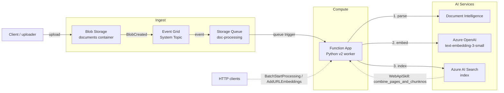

# doc-ingest-pipeline

Headless Azure document ingestion pipeline. Watches a Blob container, parses documents with Azure AI Document Intelligence, chunks and embeds the content, and indexes the result in Azure AI Search. Intended as a reusable foundation for downstream RAG, search, and agent solutions.

This product is **carved out** of [Azure-Samples/chat-with-your-data-solution-accelerator](https://github.com/Azure-Samples/chat-with-your-data-solution-accelerator). It reuses that repo's ingestion code while excluding chat, orchestration, chat history, PostgreSQL, Content Safety, Speech, and any UI surface.

## Architecture Overview

The pipeline is an **event-driven, headless ingestion service** on Azure. A document landing in Blob Storage raises an Event Grid event, which is delivered to a Storage Queue. A queue-triggered Azure Function then parses, chunks, embeds, and indexes the document into Azure AI Search. A small HTTP surface allows on-demand (re)processing and URL ingestion.



A detailed, editable version of the diagram lives at [.docs/architecture.drawio](.docs/architecture.drawio) (open with the Draw.io VS Code extension).

## Pipeline Workflow Execution

The service supports two embedding modes (selected by the `AZURE_SEARCH_USE_INTEGRATED_VECTORIZATION` setting) and three entry points.

### 1. Event-driven blob ingestion (primary path)

1. **Upload** — A document is written to the `documents` container in Blob Storage.
2. **Event** — Blob Storage emits a `Microsoft.Storage.BlobCreated` event to the Event Grid **system topic**. The deployed subscription listens only for creation events; automatic deletion propagation is not enabled.
3. **Enqueue** — The Event Grid subscription delivers the event to the `doc-processing` Storage Queue. Messages that fail repeatedly land in the `doc-processing-poison` queue.
4. **Trigger** — The `doc-processing` queue trigger fires `batch_push_results`, which inspects `eventType`:
   - `BlobCreated` → process/create flow.
   - `BlobDeleted` → remove the corresponding documents from the AI Search index.
5. **Parse** — `EmbedderFactory` returns a `PushEmbedder`, whose `embed_file()` calls the document-loading layer. The configured loading strategy (`layout`, `read`, or `contract`) invokes **Azure AI Document Intelligence** to extract page text, structure, and (for contracts) entities.
6. **Chunk** — Extracted pages are split into overlapping chunks by the document-chunking layer.
7. **Embed** — Each chunk is embedded via **Azure OpenAI** (`text-embedding-3-small`, 1536 dims).
8. **Index** — Chunks + vectors are uploaded to **Azure AI Search**. Contract documents are routed to the separate contract index (`AZURE_SEARCH_CONTRACT_INDEX`).
9. **Mark** — The source blob is stamped with `embeddings_added=true` metadata as an idempotency marker.

### 2. Batch (re)processing — HTTP

`POST /api/BatchStartProcessing` (`batch_start_processing`) enumerates every blob in the container and, in push mode, enqueues one `doc-processing` message per file to drive a full re-index. In Integrated Vectorization mode it triggers the AI Search indexer instead.

### 3. URL ingestion — HTTP

`POST /api/AddURLEmbeddings` (`add_url_embeddings`) ingests content reachable by URL:

- **Push mode:** the URL content is parsed, chunked, embedded, and indexed inline.
- **Integrated Vectorization mode:** the page is fetched, reduced to text (BeautifulSoup), and uploaded to Blob Storage, where the standard indexer/skillset handles embedding.

### Embedding modes

| Mode | Selected by | Who embeds | Notes |
| --- | --- | --- | --- |
| **Push** (default) | `AZURE_SEARCH_USE_INTEGRATED_VECTORIZATION=false` | The Function App (`PushEmbedder` → Azure OpenAI) | Full control over parsing/chunking/embedding in code. |
| **Integrated Vectorization** | `AZURE_SEARCH_USE_INTEGRATED_VECTORIZATION=true` | The AI Search indexer/skillset | The `combine_pages_and_chunknos` HTTP function is invoked by an AI Search **WebApiSkill** to zip page text with chunk numbers. |

## Solution Components

### Application (Azure Functions — Python v2 worker)

Entry point: [src/functions/function_app.py](src/functions/function_app.py). It registers four blueprints (the parent's chat blueprint is intentionally **not** registered — this service is headless):

| Component | Trigger | Responsibility |
| --- | --- | --- |
| `batch_push_results` | Queue (`doc-processing`) | Core pipeline: parse → chunk → embed → index; handles blob create/delete events. |
| `batch_start_processing` | HTTP (`BatchStartProcessing`) | Enqueue all blobs for (re)processing, or kick off the indexer in IV mode. |
| `add_url_embeddings` | HTTP (`AddURLEmbeddings`) | Ingest content from a URL (inline embed or upload-to-blob). |
| `combine_pages_and_chunknos` | HTTP (`combine_pages_and_chunknos`) | AI Search **WebApiSkill** helper used in Integrated Vectorization mode. |

Supporting utility layers (under [src/utilities/](src/utilities/)):

- **Embedders** (`helpers/embedders/`) — `EmbedderFactory`, `PushEmbedder`, `IntegratedVectorizationEmbedder`.
- **Document loading** (`document_loading/`) — `read`, `layout`, `contract`, and `web` strategies wrapping Document Intelligence and HTML parsing.
- **Document chunking** (`document_chunking/`) — fixed-size-overlap, layout, page, paragraph, and JSON strategies.
- **Helpers** (`helpers/`) — Blob/Queue clients, Document Intelligence client, AI Search helper, `EnvHelper`/`ConfigHelper`, and `azure_credential_utils` (Managed Identity first, key fallback for local dev).

### Azure resources (provisioned by [infra/main.bicep](infra/main.bicep))

| Resource | Role in the solution |
| --- | --- |
| **Storage Account** | Hosts the `documents` blob container, the `doc-processing` and `doc-processing-poison` queues, and `AzureWebJobsStorage` for the Function runtime. |
| **Event Grid System Topic** | Emits blob lifecycle events and routes them to the processing queue. |
| **Function App + App Service Plan** (Linux Flex Consumption, FC1, Python 3.11) | Runs the ingestion code with a system-assigned managed identity. |
| **Azure AI Document Intelligence** (`FormRecognizer`) | Parses documents (`prebuilt-read` / `prebuilt-layout` / `prebuilt-contract`). |
| **Azure OpenAI** + `text-embedding-3-small` deployment | Generates 1536-dim embeddings in push mode. |
| **Azure AI Search** | Stores chunks and vectors; serves the document and contract indexes. |
| **Key Vault** (RBAC mode) | Secrets backing Function App app settings. |
| **Log Analytics + Application Insights** | Telemetry, logs, and monitoring for the Function App. |
| **Role assignments** | Least-privilege RBAC granting the Function App's managed identity access to Storage, Search, Document Intelligence, OpenAI, and Key Vault (managed-identity-first per DEC-005). |

The resource group and all resources that support Azure tags receive `SecurityControl=Ignore` and `CostControl=Ignore`. Child resources that do not support tags, such as blob containers, queues, and role assignments, are not tagged.

## Features

### Document Analysis Models

The pipeline supports multiple Azure AI Document Intelligence models for different document types:

- **`prebuilt-layout`** (default): General-purpose document parsing with table detection, paragraph roles, and structure preservation
- **`prebuilt-read`**: Optimized for text extraction from simple documents
- **`prebuilt-contract`**: Specialized model for contract documents that extracts:
  - Contract type (NDA, employment agreement, lease, etc.)
  - Parties entering into the contract
  - Key dates (effective date, expiration, renewal)
  - Clauses (payment terms, termination, liability, confidentiality, indemnification)
  - Monetary amounts and payment terms
  - Addresses referenced in the contract

Configure the model using the `DOCUMENT_LOADING_STRATEGY` environment variable (values: `layout`, `read`, `contract`).

### Contract Processing

When using `DOCUMENT_LOADING_STRATEGY=contract`, documents are analyzed with the `prebuilt-contract` model and indexed in a separate contract-specific index (`AZURE_SEARCH_CONTRACT_INDEX`). This index includes specialized fields for contract entities, enabling:
- Filtering by contract type, parties, or dates
- Semantic search over contract clauses
- Faceted navigation by contract attributes

## Status

> **Spec 0002 / Bicep MVP** -- the full ingestion pipeline is ported: the queue-triggered worker parses, chunks, embeds, and indexes documents end-to-end, the HTTP endpoints (`BatchStartProcessing`, `AddURLEmbeddings`, `combine_pages_and_chunknos`) are wired up, and the Bicep modules provision the complete Azure footprint (Storage, Event Grid, Function App, Document Intelligence, Azure OpenAI, AI Search, Key Vault, and monitoring).

> **First time in this repo?** Read [HANDOFF.md](HANDOFF.md) before doing anything else. It walks through `poetry install`, lockfile generation, local verification, and picking the next spec.

## Documentation

- Product mission: [.docs/product/mission.md](.docs/product/mission.md)
- Tech stack: [.docs/product/tech-stack.md](.docs/product/tech-stack.md)
- Roadmap: [.docs/product/roadmap.md](.docs/product/roadmap.md)
- Decisions log (override authority): [.docs/product/decisions.md](.docs/product/decisions.md)
- Code style: [.docs/standards/code-style.md](.docs/standards/code-style.md)
- Best practices: [.docs/standards/best-practices.md](.docs/standards/best-practices.md)
- Component reuse map (what is copied from the parent and at what SHA): [component-reuse-map.md](component-reuse-map.md)
- Active specs: [.docs/specs/](.docs/specs/)

## Local Development

Prerequisites: Python 3.10+, Poetry, Azure Functions Core Tools (`func`).

```pwsh
poetry install
poetry run pre-commit install
poetry run pytest -q
```

To start the function host locally:

```pwsh
cd src/functions
func host start
```

Per [decisions.md](.docs/product/decisions.md) (DEC-005), service-to-service auth uses Managed Identity. For local development, sign in with `az login` so `DefaultAzureCredential` can acquire tokens.

## Deploy to Azure

These instructions deploy the ingestion service in this checkout, using
[azure.yaml](azure.yaml) and [infra/main.bicep](infra/main.bicep). No web UI or
assessment agent is deployed. Provisioning and document processing incur Azure
charges.

Run the examples from the **repository root in PowerShell 7**, in the same
terminal. Stop on any failed command. If you open a new terminal, restore the
variables and virtual-environment PATH before continuing.

### 1. Check prerequisites and Azure permissions

- Install [Azure CLI](https://learn.microsoft.com/cli/azure/install-azure-cli),
  [Azure Developer CLI (`azd`)](https://learn.microsoft.com/azure/developer/azure-developer-cli/install-azd),
  Python **3.11** (matching the deployed runtime), and PowerShell 7 through your
  approved software channel. Poetry is needed for the development checks above,
  but not for the runtime dependency installation below.
- Use a subscription where you can create resource groups and resources **and
  assign Azure roles**: for example, Contributor plus User Access Administrator
  at subscription scope, or equivalent approved permissions. Contributor alone
  cannot create the template's role assignments.
- Have your subscription administrator confirm registration of
  `Microsoft.Web`, `Microsoft.Storage`, `Microsoft.EventGrid`,
  `Microsoft.CognitiveServices`, `Microsoft.Search`, `Microsoft.KeyVault`,
  `Microsoft.Insights`, and `Microsoft.OperationalInsights`.
- Confirm your target region is allowed by organizational policy and supports
  Flex Consumption, AI Search, Document Intelligence, and the Azure OpenAI
  `text-embedding-3-small` model, version `1`, with **GlobalStandard capacity 30**.
  Model availability and quota vary by subscription and region. East US 2 is
  an option only if these checks pass; no region is guaranteed to work.
- Review the template's public network access and its
  `SecurityControl=Ignore` / `CostControl=Ignore` tags with your administrator.
  This template does not configure private endpoints or VNET integration.
  GlobalStandard embeddings do not guarantee processing stays in the resource's
  region.

```powershell
$ErrorActionPreference = 'Stop'
if ($PSVersionTable.PSVersion.Major -lt 7) {
    throw 'Open PowerShell 7 (pwsh) before continuing.'
}
az version
if ($LASTEXITCODE -ne 0) { throw 'Azure CLI is unavailable.' }
azd version
if ($LASTEXITCODE -ne 0) { throw 'Azure Developer CLI is unavailable.' }
py -3.11 --version
if ($LASTEXITCODE -ne 0) { throw 'Python 3.11 is unavailable.' }
```

### 2. Prepare the Python environment and deployment files

Use the approved package proxy, with no public-feed fallback:

```powershell
$env:PIP_CONFIG_FILE = 'NUL'
$env:PIP_INDEX_URL = 'https://packagefeedproxy.microsoft.io/pypi/simple'
$env:PIP_EXTRA_INDEX_URL = ''

if (-not (Test-Path .\.venv\Scripts\python.exe)) {
    py -3.11 -m venv .venv
    if ($LASTEXITCODE -ne 0) { throw 'Virtual environment creation failed.' }
}
$env:PATH = "$(Join-Path $PWD '.venv\Scripts');$env:PATH"
python --version
python -m pip install -r .\src\functions\requirements.txt
if ($LASTEXITCODE -ne 0) { throw 'Runtime dependency installation failed.' }
python -m pip check
if ($LASTEXITCODE -ne 0) { throw 'Dependency validation failed.' }
```

Ensure an existing virtual environment also uses Python 3.11. If Windows reports
an access-denied error for a loaded package, stop the local Function host or
debugger using that environment before retrying. Do not bypass the approved feed.
The pip variables apply to this terminal; they do not configure Poetry sources or
an Azure-hosted build. Verify packaging logs use the approved feed, and stop if a
remote build requires additional feed configuration.

**Copy utilities before every package/deploy.** The service root is
`src/functions`, but canonical utilities live in `src/utilities`; this checkout
has no automatic synchronization hook. Refresh only the ignored deployment copy:

```powershell
if (Test-Path .\src\functions\utilities) {
    Remove-Item .\src\functions\utilities -Recurse -Force
}
Copy-Item .\src\utilities -Destination .\src\functions -Recurse -Force
if (-not (Test-Path .\src\functions\utilities\helpers\env_helper.py)) {
    throw 'Deployment utilities are missing.'
}
```

Do not edit or commit the generated copy. Never remove the canonical
`src/utilities` directory.

### 3. Sign in and select the deployment environment

These commands assume an interactive **user** login. For service-principal
automation, supply its object ID and set `AZURE_PRINCIPAL_TYPE=ServicePrincipal`
instead of resolving a signed-in user.

```powershell
$TenantId = Read-Host 'Azure tenant ID'
$SubscriptionId = Read-Host 'Azure subscription ID'
$Environment = 'doc-ingest-dev'
$Location = Read-Host 'Approved Azure region (for example eastus2 or northcentralus)'

az login --tenant $TenantId
if ($LASTEXITCODE -ne 0) { throw 'Azure CLI sign-in failed.' }
az account set --subscription $SubscriptionId
if ($LASTEXITCODE -ne 0) { throw 'Subscription selection failed.' }
azd auth login --tenant-id $TenantId
if ($LASTEXITCODE -ne 0) { throw 'Azure Developer CLI sign-in failed.' }

$PrincipalId = az ad signed-in-user show --query id --output tsv
if ($LASTEXITCODE -ne 0 -or -not $PrincipalId) {
    throw 'Unable to resolve the signed-in user object ID.'
}

azd env new $Environment --subscription $SubscriptionId --location $Location
if ($LASTEXITCODE -ne 0) { throw 'Environment creation failed.' }
azd env set AZURE_PRINCIPAL_ID $PrincipalId
if ($LASTEXITCODE -ne 0) { throw 'Principal configuration failed.' }
azd env set AZURE_PRINCIPAL_TYPE User
if ($LASTEXITCODE -ne 0) { throw 'Principal type configuration failed.' }
azd env set AZURE_SEARCH_USE_INTEGRATED_VECTORIZATION false
if ($LASTEXITCODE -ne 0) { throw 'Ingestion mode configuration failed.' }
az account show --query '{subscription:id,tenant:tenantId,name:name}' --output json
```

If the environment already exists, use `azd env select $Environment` **instead
of** `azd env new`. Check its subscription and location using
`azd env get-value AZURE_SUBSCRIPTION_ID` and
`azd env get-value AZURE_LOCATION`. Do not change the location of an existing
deployment casually: resource names depend on it. New environments must set a
location explicitly; the parameter-file fallback is `swedencentral`.

### 4. Preview, provision, and deploy

Review the preview before creating resources. The current defaults are Push
mode, contract extraction, Basic AI Search, Standard LRS Storage, and S0
cognitive services. Contract results go to `doc-ingest-contracts`, not the
general `doc-ingest-index`.

```powershell
azd provision --preview --environment $Environment
if ($LASTEXITCODE -ne 0) { throw 'Infrastructure preview failed.' }
```

After approving the proposed changes:

```powershell
azd provision --environment $Environment
if ($LASTEXITCODE -ne 0) { throw 'Infrastructure provisioning failed.' }
azd deploy function --environment $Environment
if ($LASTEXITCODE -ne 0) { throw 'Function deployment failed.' }
```

`azd up --environment $Environment` combines provisioning and deployment, but the
separate commands make it easier to review changes and diagnose failures.
`azd env set` changes local deployment inputs; it does not immediately update
Function App settings. Provisioning reconciles those settings and can overwrite
Portal changes.

For code-only updates, refresh the utility copy in step 2 and run
`azd deploy function --environment $Environment`; do not reprovision unnecessarily.
Before updating an existing environment, retain a known-working deployment
package and a securely stored settings backup. Flex Consumption does not provide
deployment slots for rollback.

### 5. Verify deployment with one approved PDF

Load resource names from deployment outputs, not from examples in another
environment:

```powershell
$ResourceGroup = azd env get-value AZURE_RESOURCE_GROUP --environment $Environment
if ($LASTEXITCODE -ne 0) { throw 'Resource group output lookup failed.' }
$FunctionApp = azd env get-value SERVICE_FUNCTION_NAME --environment $Environment
if ($LASTEXITCODE -ne 0) { throw 'Function App output lookup failed.' }
$Storage = azd env get-value AZURE_BLOB_ACCOUNT_NAME --environment $Environment
if ($LASTEXITCODE -ne 0) { throw 'Storage output lookup failed.' }
az functionapp function list --resource-group $ResourceGroup `
    --name $FunctionApp --subscription $SubscriptionId --query '[].name' --output table
if ($LASTEXITCODE -ne 0) { throw 'Function registration lookup failed.' }
```

Expected: `batch_push_results`, `batch_start_processing`, `add_url_embeddings`,
and `combine_pages_and_chunknos`. An empty list or worker/import error is a failed
deployment, not a successful ingestion test.

Upload exactly one small, approved, non-sensitive PDF. This invokes paid parsing
and embedding. Use a simple unique filename for the initial smoke test:

```powershell
$Fixture = Read-Host 'Full local path to the approved test PDF'
if (-not (Test-Path -LiteralPath $Fixture -PathType Leaf)) {
    throw 'Test PDF does not exist.'
}
$BlobName = 'deployment-smoke/' + (Get-Date -Format 'yyyyMMddHHmmss') + '/policy.pdf'
az storage blob upload --account-name $Storage --container-name documents `
    --name $BlobName --file $Fixture --auth-mode login --overwrite false --output none
if ($LASTEXITCODE -ne 0) { throw 'Test upload failed.' }
```

Allow a few minutes, then inspect metadata:

```powershell
az storage blob show --account-name $Storage --container-name documents `
    --name $BlobName --auth-mode login --query metadata --output json
if ($LASTEXITCODE -ne 0) { throw 'Source metadata lookup failed.' }
```

Success requires **both** `embeddings_added: "true"` and matching document chunks
in AI Search. In Azure Portal, open the Search service's **Search explorer** and
inspect `doc-ingest-contracts` for the test document. The application creates the
index during processing; an absent index before the first upload is not itself a
provisioning failure.

If metadata is `{}`, completion is unconfirmed. Inspect Function App Application
Insights failures and use **Peek**, not Dequeue, on `doc-processing-poison`.
Stop if processing fails; do not repeatedly upload, drain the queue, invoke
`BatchStartProcessing` (which processes the whole container), or manually set the
completion marker.

Most ingestion HTTP endpoints require a Function key in the `x-functions-key`
header; `az login` does not authenticate these requests. Obtain the appropriate
key from **Function App > App keys**, enter it securely, and never put keys in
source, URLs, logs, or chat. The `combine_pages_and_chunknos` helper is anonymous;
do not treat all endpoints as protected.

### Troubleshooting and cleanup

- **Policy, region, or model/quota failure:** resolve the specific deployment
  error with your Azure administrator. Do not bypass policy or blindly move an
  existing environment to a different region.
- **403 during provisioning/deployment/upload:** verify role-assignment
  permissions and the deploying principal ID. The template grants the deploying
  principal Storage Blob Data Contributor and Search Index Data Reader. Allow
  time for RBAC propagation; do not switch to account keys to bypass it.
- **Worker import failure:** confirm the utility copy exists in the deployed
  package and that dependencies installed successfully.
- **Processing failure:** inspect the actual invocation exception before
  retrying. A poison event identifies the document but does not contain the
  processing exception.
- **Teardown:** only for an environment you intentionally want to destroy, run
  `azd down --environment $Environment` and review the confirmation. It deletes
  resources and ingested data. Do not use teardown as a routine retry; Key Vault
  purge protection can prevent immediate permanent deletion.

For command details, see the
[Azure Developer CLI reference](https://learn.microsoft.com/azure/developer/azure-developer-cli/reference).

## License

[MIT](LICENSE.md) -- matches the parent accelerator per DEC-006.
