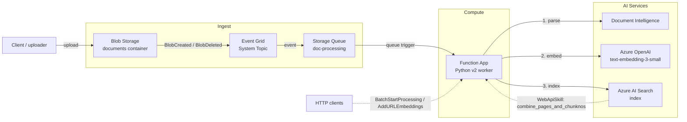

# doc-ingest-pipeline

Headless Azure document ingestion pipeline. Watches a Blob container, parses documents with Azure AI Document Intelligence, chunks and embeds the content, and indexes the result in Azure AI Search. Intended as a reusable foundation for downstream RAG, search, and agent solutions.

This product is **carved out** of [Azure-Samples/chat-with-your-data-solution-accelerator](https://github.com/Azure-Samples/chat-with-your-data-solution-accelerator). It reuses that repo's ingestion code while excluding chat, orchestration, chat history, PostgreSQL, Content Safety, Speech, and any UI surface.

## Architecture Overview

The pipeline is an **event-driven, headless ingestion service** on Azure. A document landing in Blob Storage raises an Event Grid event, which is delivered to a Storage Queue. A queue-triggered Azure Function then parses, chunks, embeds, and indexes the document into Azure AI Search. A small HTTP surface allows on-demand (re)processing and URL ingestion.



A detailed, editable version of the diagram lives at [.docs/architecture.drawio](.docs/architecture.drawio) (open with the Draw.io VS Code extension).

## Pipeline Workflow Execution

The service supports two embedding modes (selected by the `AZURE_SEARCH_USE_INTEGRATED_VECTORIZATION` setting) and three entry points.

### 1. Event-driven blob ingestion (primary path)

1. **Upload** — A document is written to the `documents` container in Blob Storage.
2. **Event** — Blob Storage emits a `Microsoft.Storage.BlobCreated` (or `BlobDeleted`) event to the Event Grid **system topic**.
3. **Enqueue** — The Event Grid subscription delivers the event to the `doc-processing` Storage Queue. Messages that fail repeatedly land in the `doc-processing-poison` queue.
4. **Trigger** — The `doc-processing` queue trigger fires `batch_push_results`, which inspects `eventType`:
   - `BlobCreated` → process/create flow.
   - `BlobDeleted` → remove the corresponding documents from the AI Search index.
5. **Parse** — `EmbedderFactory` returns a `PushEmbedder`, whose `embed_file()` calls the document-loading layer. The configured loading strategy (`layout`, `read`, or `contract`) invokes **Azure AI Document Intelligence** to extract page text, structure, and (for contracts) entities.
6. **Chunk** — Extracted pages are split into overlapping chunks by the document-chunking layer.
7. **Embed** — Each chunk is embedded via **Azure OpenAI** (`text-embedding-3-small`, 1536 dims).
8. **Index** — Chunks + vectors are uploaded to **Azure AI Search**. Contract documents are routed to the separate contract index (`AZURE_SEARCH_CONTRACT_INDEX`).
9. **Mark** — The source blob is stamped with `embeddings_added=true` metadata as an idempotency marker.

### 2. Batch (re)processing — HTTP

`POST /api/BatchStartProcessing` (`batch_start_processing`) enumerates every blob in the container and, in push mode, enqueues one `doc-processing` message per file to drive a full re-index. In Integrated Vectorization mode it triggers the AI Search indexer instead.

### 3. URL ingestion — HTTP

`POST /api/AddURLEmbeddings` (`add_url_embeddings`) ingests content reachable by URL:

- **Push mode:** the URL content is parsed, chunked, embedded, and indexed inline.
- **Integrated Vectorization mode:** the page is fetched, reduced to text (BeautifulSoup), and uploaded to Blob Storage, where the standard indexer/skillset handles embedding.

### Embedding modes

| Mode | Selected by | Who embeds | Notes |
| --- | --- | --- | --- |
| **Push** (default) | `AZURE_SEARCH_USE_INTEGRATED_VECTORIZATION=false` | The Function App (`PushEmbedder` → Azure OpenAI) | Full control over parsing/chunking/embedding in code. |
| **Integrated Vectorization** | `AZURE_SEARCH_USE_INTEGRATED_VECTORIZATION=true` | The AI Search indexer/skillset | The `combine_pages_and_chunknos` HTTP function is invoked by an AI Search **WebApiSkill** to zip page text with chunk numbers. |

## Solution Components

### Application (Azure Functions — Python v2 worker)

Entry point: [src/functions/function_app.py](src/functions/function_app.py). It registers four blueprints (the parent's chat blueprint is intentionally **not** registered — this service is headless):

| Component | Trigger | Responsibility |
| --- | --- | --- |
| `batch_push_results` | Queue (`doc-processing`) | Core pipeline: parse → chunk → embed → index; handles blob create/delete events. |
| `batch_start_processing` | HTTP (`BatchStartProcessing`) | Enqueue all blobs for (re)processing, or kick off the indexer in IV mode. |
| `add_url_embeddings` | HTTP (`AddURLEmbeddings`) | Ingest content from a URL (inline embed or upload-to-blob). |
| `combine_pages_and_chunknos` | HTTP (`combine_pages_and_chunknos`) | AI Search **WebApiSkill** helper used in Integrated Vectorization mode. |

Supporting utility layers (under [src/utilities/](src/utilities/)):

- **Embedders** (`helpers/embedders/`) — `EmbedderFactory`, `PushEmbedder`, `IntegratedVectorizationEmbedder`.
- **Document loading** (`document_loading/`) — `read`, `layout`, `contract`, and `web` strategies wrapping Document Intelligence and HTML parsing.
- **Document chunking** (`document_chunking/`) — fixed-size-overlap, layout, page, paragraph, and JSON strategies.
- **Helpers** (`helpers/`) — Blob/Queue clients, Document Intelligence client, AI Search helper, `EnvHelper`/`ConfigHelper`, and `azure_credential_utils` (Managed Identity first, key fallback for local dev).

### Azure resources (provisioned by [infra/main.bicep](infra/main.bicep))

| Resource | Role in the solution |
| --- | --- |
| **Storage Account** | Hosts the `documents` blob container, the `doc-processing` and `doc-processing-poison` queues, and `AzureWebJobsStorage` for the Function runtime. |
| **Event Grid System Topic** | Emits blob lifecycle events and routes them to the processing queue. |
| **Function App + App Service Plan** (Linux, Python 3.11, B1) | Runs the ingestion code with a system-assigned managed identity. |
| **Azure AI Document Intelligence** (`FormRecognizer`) | Parses documents (`prebuilt-read` / `prebuilt-layout` / `prebuilt-contract`). |
| **Azure OpenAI** + `text-embedding-3-small` deployment | Generates 1536-dim embeddings in push mode. |
| **Azure AI Search** | Stores chunks and vectors; serves the document and contract indexes. |
| **Key Vault** (RBAC mode) | Secrets backing Function App app settings. |
| **Log Analytics + Application Insights** | Telemetry, logs, and monitoring for the Function App. |
| **Role assignments** | Least-privilege RBAC granting the Function App's managed identity access to Storage, Search, Document Intelligence, OpenAI, and Key Vault (managed-identity-first per DEC-005). |

The resource group and all resources that support Azure tags receive `SecurityControl=Ignore` and `CostControl=Ignore`. Child resources that do not support tags, such as blob containers, queues, and role assignments, are not tagged.

## Features

### Document Analysis Models

The pipeline supports multiple Azure AI Document Intelligence models for different document types:

- **`prebuilt-layout`** (default): General-purpose document parsing with table detection, paragraph roles, and structure preservation
- **`prebuilt-read`**: Optimized for text extraction from simple documents
- **`prebuilt-contract`**: Specialized model for contract documents that extracts:
  - Contract type (NDA, employment agreement, lease, etc.)
  - Parties entering into the contract
  - Key dates (effective date, expiration, renewal)
  - Clauses (payment terms, termination, liability, confidentiality, indemnification)
  - Monetary amounts and payment terms
  - Addresses referenced in the contract

Configure the model using the `DOCUMENT_LOADING_STRATEGY` environment variable (values: `layout`, `read`, `contract`).

### Contract Processing

When using `DOCUMENT_LOADING_STRATEGY=contract`, documents are analyzed with the `prebuilt-contract` model and indexed in a separate contract-specific index (`AZURE_SEARCH_CONTRACT_INDEX`). This index includes specialized fields for contract entities, enabling:
- Filtering by contract type, parties, or dates
- Semantic search over contract clauses
- Faceted navigation by contract attributes

## Status

> **Spec 0002 / Bicep MVP** -- the full ingestion pipeline is ported: the queue-triggered worker parses, chunks, embeds, and indexes documents end-to-end, the HTTP endpoints (`BatchStartProcessing`, `AddURLEmbeddings`, `combine_pages_and_chunknos`) are wired up, and the Bicep modules provision the complete Azure footprint (Storage, Event Grid, Function App, Document Intelligence, Azure OpenAI, AI Search, Key Vault, and monitoring).

> **First time in this repo?** Read [HANDOFF.md](HANDOFF.md) before doing anything else. It walks through `poetry install`, lockfile generation, local verification, and picking the next spec.

## Documentation

- Product mission: [.docs/product/mission.md](.docs/product/mission.md)
- Tech stack: [.docs/product/tech-stack.md](.docs/product/tech-stack.md)
- Roadmap: [.docs/product/roadmap.md](.docs/product/roadmap.md)
- Decisions log (override authority): [.docs/product/decisions.md](.docs/product/decisions.md)
- Code style: [.docs/standards/code-style.md](.docs/standards/code-style.md)
- Best practices: [.docs/standards/best-practices.md](.docs/standards/best-practices.md)
- Component reuse map (what is copied from the parent and at what SHA): [component-reuse-map.md](component-reuse-map.md)
- Active specs: [.docs/specs/](.docs/specs/)

## Local Development

Prerequisites: Python 3.10+, Poetry, Azure Functions Core Tools (`func`).

```pwsh
poetry install
poetry run pre-commit install
poetry run pytest -q
```

To start the function host locally:

```pwsh
cd src/functions
func host start
```

Per [decisions.md](.docs/product/decisions.md) (DEC-005), service-to-service auth uses Managed Identity. For local development, sign in with `az login` so `DefaultAzureCredential` can acquire tokens.

## License

[MIT](LICENSE.md) -- matches the parent accelerator per DEC-006.
