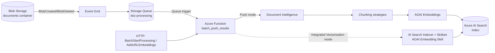

# Component Reuse Map

> Last Updated: 2026-06-02
> Version: 1.0.0
> Source repo: [Azure-Samples/chat-with-your-data-solution-accelerator](https://github.com/Azure-Samples/chat-with-your-data-solution-accelerator)
> Source branch / commit at planning time: `main` (record exact SHA at time of copy in each row's "Notes" column)

This document is the authoritative list of which parts of the parent accelerator are reused, modified, or skipped in **doc-ingest-pipeline**. All paths are **relative to the parent repo root**. Target paths assume the new repo root.

## Legend

- **REUSE** - copy as-is, only update imports / module path if needed
- **MODIFY** - copy and trim or refactor (notes call out what changes)
- **SKIP** - do not bring forward; explicitly out of scope per [decisions](.docs/product/decisions.md)

## Architecture Overview (target product)

## Application Code

### Azure Functions entry points -- `code/backend/batch/`

> **Spec 0001 status:** All rows below ported from parent commit `5c99c241b3ef4f4bbbcfdcca0d4b4b3a405424c3` on 2026-06-02. Handler bodies that depend on not-yet-ported helpers raise `NotImplementedError` until spec 0002.

| Source path | Disposition | Target path | Notes |
|---|---|---|---|
| `code/backend/batch/function_app.py` | REUSE | `src/functions/function_app.py` | Ported at `5c99c24`. Rewrote blueprint imports to absolute `src.functions.*`; commented OTel import + wiring (TODO spec-0002); did not register `bp_get_conversation_response` (DEC-001, DEC-004) |
| `code/backend/batch/batch_push_results.py` | REUSE | `src/functions/batch_push_results.py` | Ported at `5c99c24`. Queue trigger preserved (`doc-processing` / `AzureWebJobsStorage`); handler body stubbed `NotImplementedError` pending spec-0002 helper port |
| `code/backend/batch/batch_start_processing.py` | REUSE | `src/functions/batch_start_processing.py` | Ported at `5c99c24`. HTTP route `BatchStartProcessing` preserved; handler body stubbed pending spec-0002 helper port |
| `code/backend/batch/add_url_embeddings.py` | REUSE | `src/functions/add_url_embeddings.py` | Ported at `5c99c24`. HTTP route `AddURLEmbeddings` preserved; `requests` + `bs4` imports parked behind TODO spec-0002; handler body stubbed |
| `code/backend/batch/combine_pages_chunknos.py` | REUSE | `src/functions/combine_pages_chunknos.py` | Ported at `5c99c24`. **Verbatim** -- no helper deps; fully functional in spec 0001 |
| `code/backend/batch/get_conversation_response.py` | SKIP | -- | Chat surface; out of scope per DEC-001 |
| `code/backend/batch/host.json` | MODIFY | `src/functions/host.json` | Ported at `5c99c24`. Verbatim (already minimal) |
| `code/backend/batch/.funcignore` | REUSE | `src/functions/.funcignore` | Ported at `5c99c24`. Added `tests`, `.pytest_cache`, `.coverage`, `htmlcov` |
| `code/backend/batch/local.settings.json.sample` | MODIFY | `src/functions/local.settings.json.sample` | Ported at `5c99c24`. Replaced parent placeholders with the six spec-0001 keys (`AzureWebJobsStorage`, `AZURE_BLOB_*`, `AZURE_SEARCH_USE_INTEGRATED_VECTORIZATION`, `DOCUMENT_PROCESSING_QUEUE_NAME`, `MANAGED_IDENTITY_CLIENT_ID`, `LOGLEVEL`) |

### Document loading -- `code/backend/batch/utilities/document_loading/`

| Source path | Disposition | Target path | Notes |
|---|---|---|---|
| `document_loading_base.py` | REUSE | `src/utilities/document_loading/document_loading_base.py` | |
| `read.py` | REUSE | `src/utilities/document_loading/read.py` | Document Intelligence `read` |
| `layout.py` | REUSE | `src/utilities/document_loading/layout.py` | Document Intelligence `layout` |
| `web.py` | REUSE | `src/utilities/document_loading/web.py` | HTML / URL loader |
| `word_document.py` | REUSE | `src/utilities/document_loading/word_document.py` | DOCX loader |
| `strategies.py` | REUSE | `src/utilities/document_loading/strategies.py` | Strategy enum / factory |

### Document chunking -- `code/backend/batch/utilities/document_chunking/`

| Source path | Disposition | Target path | Notes |
|---|---|---|---|
| `document_chunking_base.py` | REUSE | `src/utilities/document_chunking/document_chunking_base.py` | |
| `chunking_strategy.py` | REUSE | `src/utilities/document_chunking/chunking_strategy.py` | |
| `fixed_size_overlap.py` | REUSE | `src/utilities/document_chunking/fixed_size_overlap.py` | |
| `layout.py` | REUSE | `src/utilities/document_chunking/layout.py` | |
| `page.py` | REUSE | `src/utilities/document_chunking/page.py` | |
| `paragraph.py` | REUSE | `src/utilities/document_chunking/paragraph.py` | |
| `json.py` | REUSE | `src/utilities/document_chunking/json.py` | |
| `strategies.py` | REUSE | `src/utilities/document_chunking/strategies.py` | |

### Embedders -- `code/backend/batch/utilities/helpers/embedders/`

| Source path | Disposition | Target path | Notes |
|---|---|---|---|
| `embedder_base.py` | REUSE | `src/utilities/embedders/embedder_base.py` | |
| `embedder_factory.py` | MODIFY | `src/utilities/embedders/embedder_factory.py` | Remove the PostgreSQL branch |
| `push_embedder.py` | MODIFY | `src/utilities/embedders/push_embedder.py` | Image-processing branch behind feature flag; Phase 4 by default OFF |
| `integrated_vectorization_embedder.py` | REUSE | `src/utilities/embedders/integrated_vectorization_embedder.py` | |
| `postgres_embedder.py` | SKIP | -- | DEC-002 |

### AI Search wiring -- `code/backend/batch/utilities/integrated_vectorization/`

| Source path | Disposition | Target path | Notes |
|---|---|---|---|
| `azure_search_datasource.py` | REUSE | `src/utilities/integrated_vectorization/azure_search_datasource.py` | |
| `azure_search_index.py` | REUSE | `src/utilities/integrated_vectorization/azure_search_index.py` | |
| `azure_search_indexer.py` | REUSE | `src/utilities/integrated_vectorization/azure_search_indexer.py` | |
| `azure_search_skillset.py` | REUSE | `src/utilities/integrated_vectorization/azure_search_skillset.py` | |

### Search handlers -- `code/backend/batch/utilities/search/`

| Source path | Disposition | Target path | Notes |
|---|---|---|---|
| `search.py` | MODIFY | `src/utilities/search/search.py` | Drop PG branch |
| `search_handler_base.py` | REUSE | `src/utilities/search/search_handler_base.py` | |
| `azure_search_handler.py` | REUSE | `src/utilities/search/azure_search_handler.py` | |
| `integrated_vectorization_search_handler.py` | REUSE | `src/utilities/search/integrated_vectorization_search_handler.py` | |
| `postgres_search_handler.py` | SKIP | -- | DEC-002 |

### Cross-cutting helpers -- `code/backend/batch/utilities/helpers/`

| Source path | Disposition | Target path | Notes |
|---|---|---|---|
| `azure_blob_storage_client.py` | REUSE | `src/utilities/helpers/azure_blob_storage_client.py` | |
| `azure_form_recognizer_helper.py` | REUSE | `src/utilities/helpers/azure_form_recognizer_helper.py` | Document Intelligence wrapper |
| `azure_search_helper.py` | REUSE | `src/utilities/helpers/azure_search_helper.py` | |
| `azure_credential_utils.py` | REUSE | `src/utilities/helpers/azure_credential_utils.py` | |
| `azure_computer_vision_client.py` | MODIFY | `src/utilities/helpers/azure_computer_vision_client.py` | Keep but gate via feature flag (Phase 4) |
| `azure_postgres_helper.py` | SKIP | -- | DEC-002 |
| `env_helper.py` | MODIFY | `src/utilities/helpers/env_helper.py` | Trim to ingestion-only env vars; remove chat/orchestrator/PG/Cosmos/Speech/Content-Safety keys |
| `llm_helper.py` | MODIFY | `src/utilities/helpers/llm_helper.py` | Keep `generate_embeddings`; remove chat-completion paths unless image captioning Phase 4 is enabled |
| `document_loading_helper.py` | REUSE | `src/utilities/helpers/document_loading_helper.py` | |
| `document_chunking_helper.py` | REUSE | `src/utilities/helpers/document_chunking_helper.py` | |
| `orchestrator_helper.py` | SKIP | -- | Chat orchestration |
| `prompt_utils.py` | SKIP | -- | Chat orchestration |
| `config/` (whole folder) | MODIFY | `src/utilities/helpers/config/` | Keep `ConfigHelper`, `EmbeddingConfig`, integrated_vectorization_config; remove orchestrator/prompt/chat config |

### Common types -- `code/backend/batch/utilities/common/`

| Source path | Disposition | Target path | Notes |
|---|---|---|---|
| `common/source_document.py` and siblings | REUSE | `src/utilities/common/...` | Used by loaders, chunkers, embedders |

### Modules explicitly excluded

- `code/backend/batch/utilities/orchestrator/` -- chat orchestration
- `code/backend/batch/utilities/tools/` -- chat tools
- `code/backend/batch/utilities/plugins/` -- Semantic Kernel plugins
- `code/backend/batch/utilities/parser/` -- output parsers for chat
- `code/backend/batch/utilities/chat_history/` -- Cosmos / PG chat history
- `code/backend/batch/utilities/loggers/` (parts touching chat) -- evaluate per-file; keep only generic logging utilities
- `code/backend/` everything under `api/`, `pages/`, `Admin.py` -- Flask + Streamlit
- `code/frontend/` -- React SPA
- `code/app.py`, `code/create_app.py` -- Flask app composition
- `extensions/teams/` -- Teams extension

## Infrastructure (Bicep)

> **Spec 0003 SHA policy:** Bicep modules are **re-snapped to the current parent `main` at port time**, NOT pinned to spec-0001's `5c99c241b3ef4f4bbbcfdcca0d4b4b3a405424c3`. Parent Bicep churns faster than Python; re-snapping gets fixes for free. Record the re-snap SHA in the Notes column for every file copied during spec 0003. Mixing SHAs across modules within a single spec is forbidden -- pick one SHA at the start of [spec-0003 task T0003-01](.docs/specs/2026-06-02-bicep-mvp-deploy/tasks.md) and use it for every file in that spec.

### Reused IaC modules -- `infra/modules/`

| Source path | Disposition | Target path | Notes |
|---|---|---|---|
| `infra/modules/storage/storage-account/` | REUSE | `infra/modules/storage/storage-account/` | |
| `infra/modules/cognitive-services/account/` | MODIFY | `infra/modules/cognitive-services/account/` | Provision only Document Intelligence and AOAI embeddings; drop chat model deployments |
| `infra/modules/app/function.bicep` | REUSE | `infra/modules/app/function.bicep` | |
| `infra/modules/app/eventgrid.bicep` | REUSE | `infra/modules/app/eventgrid.bicep` | Blob events to Storage Queue |
| `infra/modules/app/roleassignments.bicep` | MODIFY | `infra/modules/app/roleassignments.bicep` | Trim assignments to only Storage, Search, Document Intelligence, AOAI, Key Vault |
| `infra/modules/key-vault/` | REUSE | `infra/modules/key-vault/` | |
| `infra/modules/core/` | MODIFY | `infra/modules/core/` | Cherry-pick search service + indexer-relevant modules |
| `infra/abbreviations.json` | REUSE | `infra/abbreviations.json` | |
| `infra/main.bicep` | MODIFY | `infra/main.bicep` | New top-level composition: Storage + Queue + Event Grid + Search + DI + AOAI(embeddings) + Function + KV + RBAC |
| `infra/main.parameters.json` | MODIFY | `infra/main.parameters.json` | Strip unused parameters |

### IaC explicitly excluded

- `infra/modules/app/web.bicep`, `adminweb.bicep`, `workbook.bicep` -- web tier
- `infra/modules/document-db/` -- Cosmos DB (chat history)
- `infra/modules/private-dns-zone/`, `infra/modules/virtualNetwork.bicep` -- reintroduced in **Phase 5** for enterprise networking
- `infra/prompt-flow/`, `infra/workbooks/` -- chat-tier monitoring + prompt flow

## Tests

### Reused tests -- subset of `code/tests/`

| Source path | Disposition | Notes |
|---|---|---|
| `code/tests/test_add_url_embeddings.py` | REUSE | URL ingestion endpoint |
| Batch / ingestion tests under `code/tests/` matching `test_batch_*.py`, `test_push_embedder*.py`, `test_integrated_vectorization*.py`, `test_document_loading_*`, `test_document_chunking_*`, `test_azure_search_*` | REUSE | Carry forward; rewire imports |
| Chat / orchestrator / PG / Cosmos / Admin tests | SKIP | Out of scope |
| `code/tests/conftest.py` | MODIFY | Trim fixtures tied to skipped modules |

### Integration / e2e tests -- `tests/`

| Source path | Disposition | Notes |
|---|---|---|
| `tests/integration/` (ingestion-only subset) | MODIFY | Re-target to slimmed function app |
| `tests/e2e-test/` | SKIP | UI-driven; out of scope |
| `tests/llm-evaluator/` | SKIP | Chat-quality evaluation; out of scope |

## Docs Worth Carrying (selectively)

| Source path | Disposition | Notes |
|---|---|---|
| `docs/integrated_vectorization.md` | REUSE | Core reference for IV mode |
| `docs/advanced_image_processing.md` | REUSE | For Phase 4 |
| `docs/supported_file_types.md` | REUSE | Update to reflect ingestion-only scope |
| `docs/LOCAL_DEPLOYMENT.md` | MODIFY | Strip web/admin sections |
| `docs/customizing_azd_parameters.md` | MODIFY | Strip unused params |
| All other `docs/*` | SKIP | Chat / Teams / web-app specific |

## Upstream Sync Protocol

1. Track parent repo commit SHA at the time of each major copy; record in the Notes column above (or in a sibling `UPSTREAM_SHA.md`).
2. Quarterly (post-MVP), diff parent paths in this map against the recorded SHA and cherry-pick fixes.
3. New parent features that violate doc-ingest-pipeline scope (DEC-001, DEC-002, DEC-004) are not adopted without an ADR.
